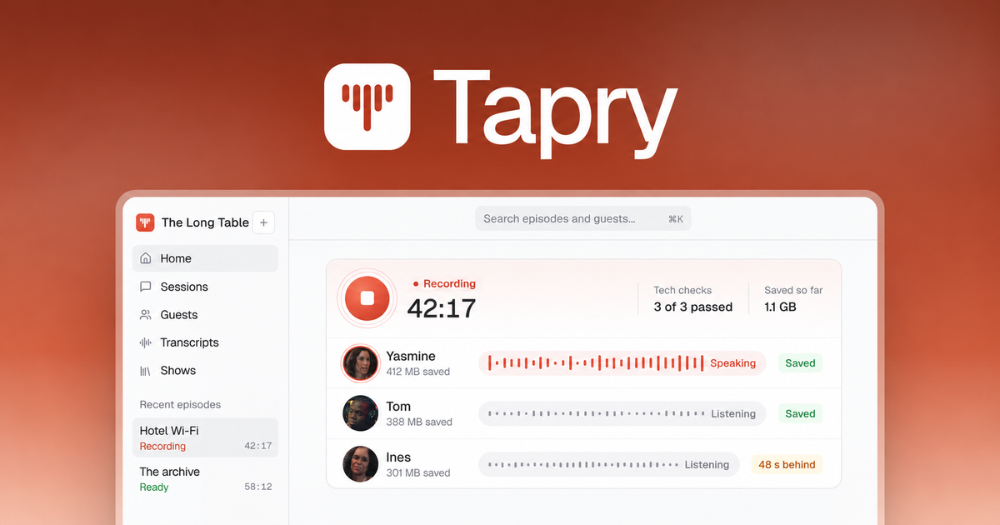

<a href="https://tapry.app">
  <picture>
    <source media="(prefers-color-scheme: dark)" srcset="https://raw.githubusercontent.com/tapry/.github/main/profile/assets/logo-on-dark.png">
    
  </picture>
</a>

### The remote recording studio you own.

Guests join from a link in their browser. Everyone is recorded on their own computer at full quality
and uploaded while you talk, so a bad connection blurs the call, never the recording. 
Open source, on your own server or hosted by us.

 

[**Get started at tapry.app**](https://tapry.app) &nbsp;·&nbsp; [**Host it yourself**](https://github.com/tapry/tapry/blob/main/docs/self-hosting.md) &nbsp;·&nbsp; [**Talk to us**](mailto:hello@tapry.app)

 

 

## What it does

- **Never lose a recording.** Each person's sound and picture are saved in their own browser and uploaded piece by piece during the session. A closed tab or a dropped connection picks up where it left off.
- **Separate files for every person.** Aligned WAV or FLAC and MP4 per person, up to 4K, plus a combined video and a shared screen as its own file.
- **The host sees what's going wrong while it can still be fixed.** Live upload status for every guest, and alerts for a mic that is clipping, silent, too quiet or echoing.
- **Private by default.** Transcripts are made on the server that holds the recording. AI notes are written only where an account turns them on.
- **Yours to keep.** Run the whole thing with Docker on your own machine, record into your own storage, and take every file with you.

## Repositories

| | |
|---|---|
| [**tapry**](https://github.com/tapry/tapry) | The studio: web app, recorder, media worker, and the Docker bundle for self-hosting. AGPL-3.0; the recorder core is MIT. |

## Find your way

- [Website](https://tapry.app) and [pricing](https://tapry.app/pricing/)
- [Self-hosting guide](https://github.com/tapry/tapry/blob/main/docs/self-hosting.md) and [tested browsers](https://github.com/tapry/tapry/blob/main/docs/browser-support.md)
- [Changelog](https://github.com/tapry/tapry/blob/main/CHANGELOG.md) and [discussions](https://github.com/tapry/tapry/discussions)
- Found a security problem? [Report it privately](https://github.com/tapry/tapry/security/advisories/new).
